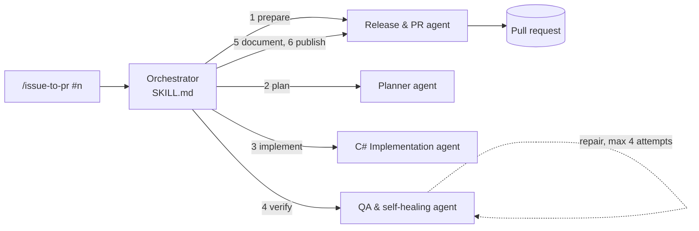

# `/issue-to-pr` agentic pack

An agentic workflow that takes a GitHub issue of this repository and autonomously turns it into a verified pull request: it analyzes the issue, creates a branch, implements the change across all layers, builds and tests with automatic repair, updates documentation, and opens the pull request.

## Runtime

The pack runs in **Claude Code**. Claude Code discovers project skills in `.claude/skills/` and offers each skill as a slash command, so `SKILL.md` in this folder provides the `/issue-to-pr` command. The skill sets `disable-model-invocation: true`, so the workflow starts only when a user invokes it explicitly.

Subagents used by the workflow are defined in `.claude/agents/`. Claude Code enforces their tool restrictions only when they are defined there; the `agents/` folder in this pack documents their roles.

## Usage

Run from the repository root, with a clean working tree and an authenticated GitHub CLI (`gh auth status`):

```text
/issue-to-pr #42
/issue-to-pr 42
/issue-to-pr https://github.com/UAI-VUT-Brno/0VP-26-27Z-StudentsGroup-Team-3/issues/42
```

Add `--dry-run` to validate the input, fetch the issue, check the rule files and show the derived branch name and planned stages without changing anything:

```text
/issue-to-pr #42 --dry-run
```

For an unattended run, start Claude Code in a permission mode that does not stop for approvals, for example `auto`.

## Architecture



| Component | Location | Responsibility |
|---|---|---|
| Orchestrator | `SKILL.md` | Input validation, issue ingestion, loading rules, stage order, stop conditions, final report |
| Rules | `rules/` | Architecture, domain, code style and git conventions; read by the orchestrator and passed to every subagent |
| Prompts | `prompts/` | Stage-specific instructions for planning, implementation, repair and PR text |
| Agent roles | `agents/`, `.claude/agents/` | Role descriptions and tool permissions of the subagents |

## Data flow

Every run stores its intermediate results in `.issue-to-pr/<issue_number>/`. The folder is ignored by git.

| File | Written by | Content |
|---|---|---|
| `issue.json` | Orchestrator | Issue metadata from `gh issue view` |
| `branch.md` | Release & PR agent | Working-tree check, base branch and created branch |
| `plan.md` | Planner agent | Requirements, acceptance criteria, affected files |
| `implementation.md` | Implementation agent | Changed files and commits |
| `qa-report.md` | QA agent | Build and test results of every attempt, files changed by repairs |
| `docs.md` | Release & PR agent | Changed documentation files, or the reason none were needed |
| `pr.md` | Release & PR agent | Pull request URL and body |

These files serve as the execution record for the benchmark and the report.

## Commits and publication

Stage 3 commits the implementation. Stages 4 (QA repairs) and 5 (documentation) leave their changes uncommitted and list every changed file. Stage 6 then publishes in this order and stops before pushing if any step fails:

1. Confirm that QA reported a successful build and test run.
2. Check the working tree: only files listed by stages 4 and 5 may be changed. Unexpected or unrelated changes stop the workflow instead of being committed.
3. Commit QA repairs and documentation as separate commits, staging files by explicit path and running `git diff --cached --check` before each commit.
4. Confirm a clean working tree: `git status --porcelain` is empty and `git diff --check` passes.
5. Validate the complete branch against the base branch: `git diff --check origin/<base>...HEAD`. The base branch is the repository default branch recorded in stage 1.
6. Push the feature branch.
7. Create the pull request against the base branch.

The workflow never merges the pull request.

## Implementation status

| Part | Issue |
|---|---|
| Orchestrator and pack structure | OVP-T3-17 |
| Rules | OVP-T3-18 |
| Planner and C# Implementation agents | OVP-T3-19 |
| QA agent with self-healing loop | OVP-T3-20 |
| Release & PR agent | OVP-T3-21 |
